<p align="center">
  
</p>

<h1 align="center">Cairn</h1>

<p align="center">
  把看过的网页、视频、文章收进本地知识库，让模型整理成可检索、可复习的知识资产。<br/>
  单机运行 · 数据在你自己的硬盘上
</p>

<p align="center">
  <a href="https://chenyiming-aaa.github.io/Cairn-StudyKB/"><b>▶ 在线试用</b></a> ·
  <a href="https://github.com/ChenYiming-aaa/Cairn-StudyKB/releases">下载 Windows 版</a> ·
  <a href="#界面">截图</a> ·
  <a href="#它能做什么">功能</a> ·
  <a href="#常见问题">常见问题</a>
</p>

<p align="center">
  <a href="LICENSE"></a>
  
  
  
</p>

---

> **cairn** /kɛərn/ · 登山者沿途堆的石堆路标。走一段留一块石头，靠自己堆的标记找得回来。

## 这是什么

看过的东西大多留不下来：网页关掉就散了，视频看完只剩「我好像学过」，摘抄攒了一堆却从没回头读过。

Cairn 把这条链路接上：**链接丢进去 → 自动抽正文、由模型分类、写摘要和整理笔记 → 之后能按语义搜出来、能生成学习页、能自动出题考你、答错的题按间隔重复回来找你。** 学多久也有记录，仪表盘上一眼看到今天该干什么。

它是给一个人用的工具，不是平台：没有账号、没有云同步、没有多人协作，全部内容在一个本地 SQLite 文件里，唯一出网的动作是调用你自己配置的模型接口。**不做**云端存储、不支持团队、不替你「读完」——采集是自动化，理解还得你自己看、自己写。

## 在线试用

**<https://chenyiming-aaa.github.io/Cairn-StudyKB/>**

不用安装、不用注册的只读演示，里面是一份真实的样例知识库（6 篇学习方法笔记，真跑过整理、问答、出题）。

- ✅ **能看**：知识库与分类树、内容详情（摘要 / 要点 / 笔记）、思维导图、带 `[n]` 引用的问答历史、离线学习页、复习作答与判分、仪表盘
- ⛔ **不能做**：采集、整理、生成问答、出题——这些要本地后端和模型，演示版会明确说「下载桌面版就能用」，**不会假装在生成**
- 数据是构建时打包的快照，你的点击不会被保存；也不代表本机运行速度

## 界面

**知识库** · 顶部一条「今日」概览（待整理 / 待复习 / 连续天数 / 专注，点进完整仪表盘），下面三栏：左边自动生成的分类与标签树，中间内容列表，右边选中内容的摘要与要点（笔记、原文、导图、学习记录各占一个页签）。三栏都能收能拖并记住。

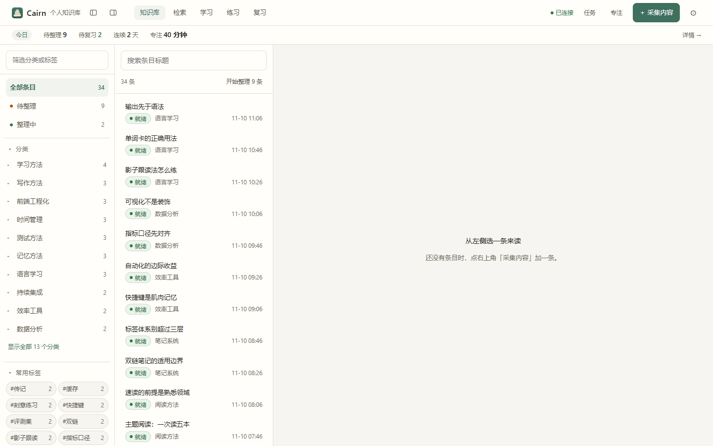

**内容详情** · 模型重写标题、给摘要、拆要点、写 Markdown 笔记；笔记可手改，改完索引自动重建。

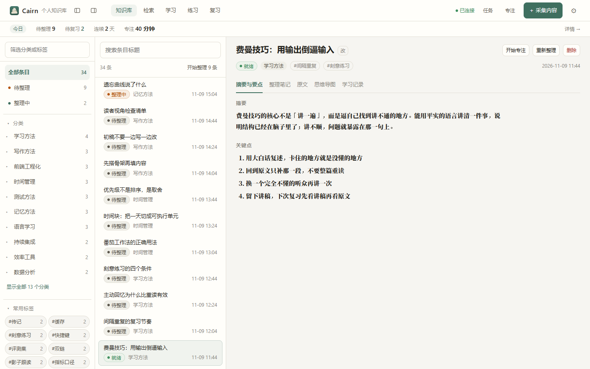

**思维导图** · 按笔记标题层级现场出图，配色跟着主题走（换「学习紫」就是紫色系），用来看自己的理解结构有没有断层。

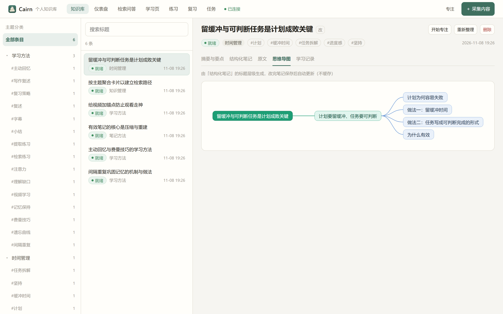

**检索问答** · 对整库提问，答案分条带 `[n]` 引用，点引用跳原文高亮；搜不到就说「库里没有」，不硬编。

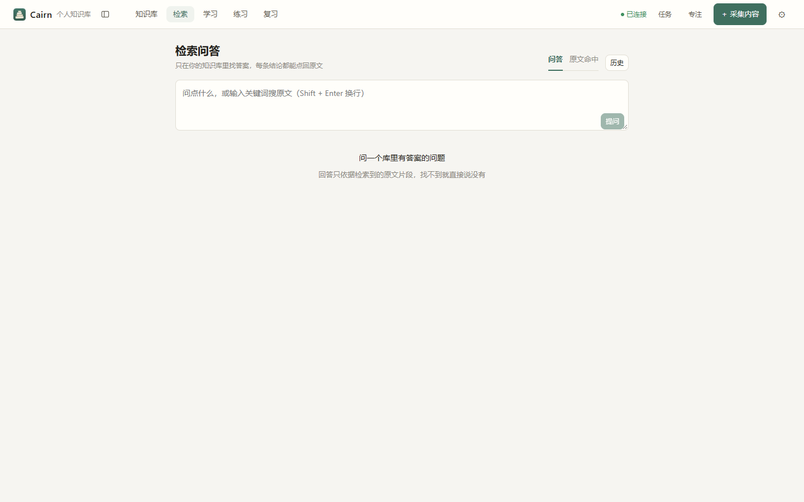

**学习页** · 多选内容生成一份**单文件离线** HTML（内联样式、内嵌导图、代码高亮），能断网打开、能直接发给别人。预览区固定浅色排版（打印友好），外面套一圈深色「桌面」，深色模式下不会白得刺眼。

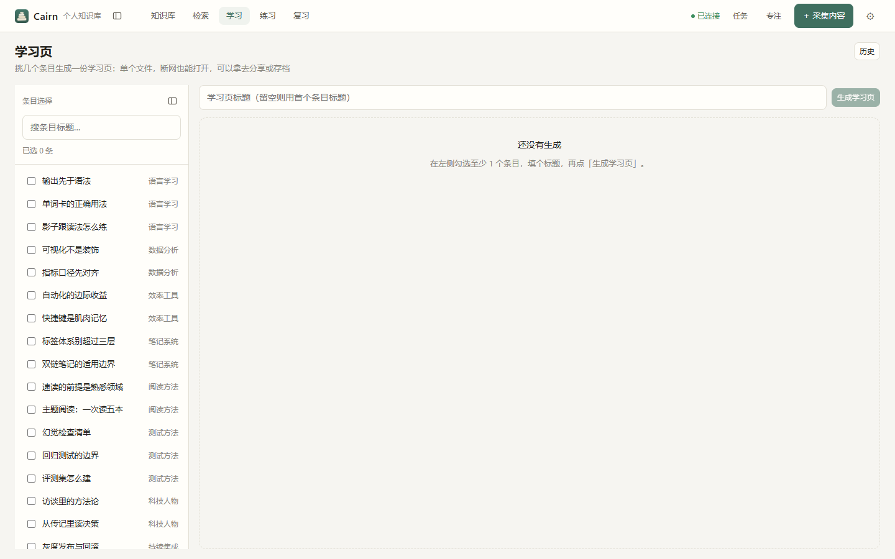

**复习** · 答错的题按 1 → 2 → 4 → 7 → 15 天回来，到期出现在这里，一题一屏，答完立刻给判定和解析。

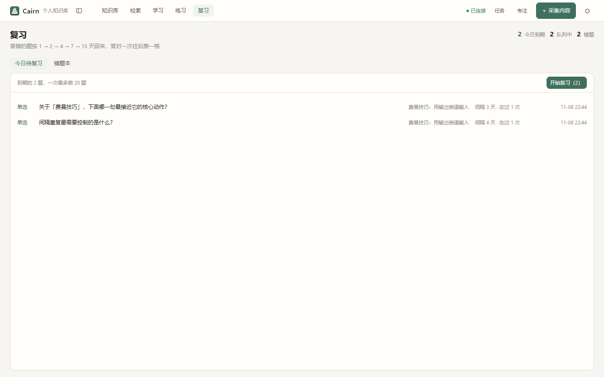

**练习** · 选一条已整理的内容，挑题型（单选 / 多选 / 判断 / 简答）、难度、题数，题面逐题流式浮现。

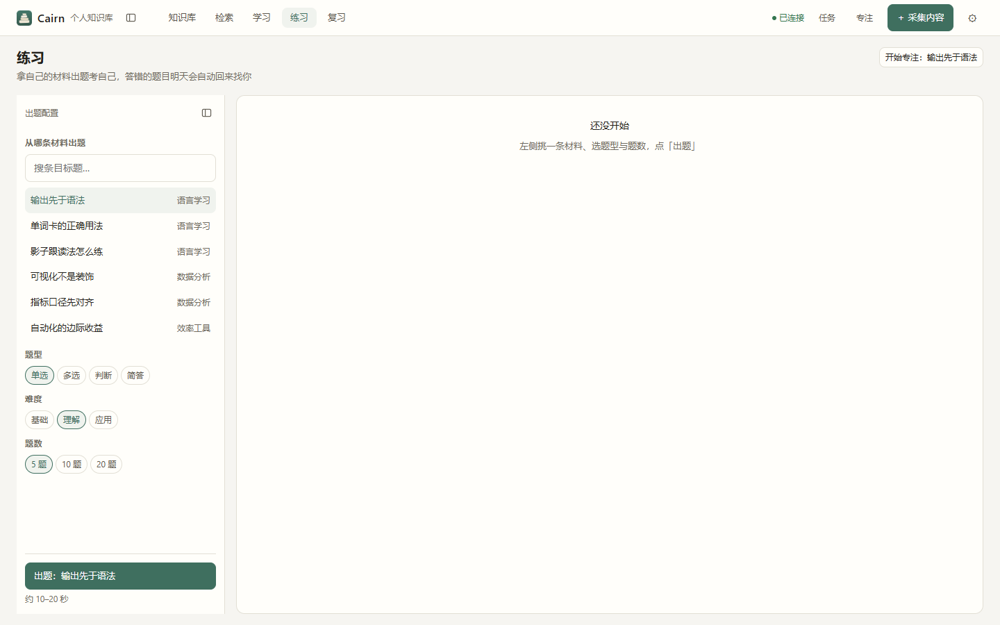

**仪表盘** · 今日待整理、今日待复习、连续学习天数、今日正确率、本周专注、分类分布。

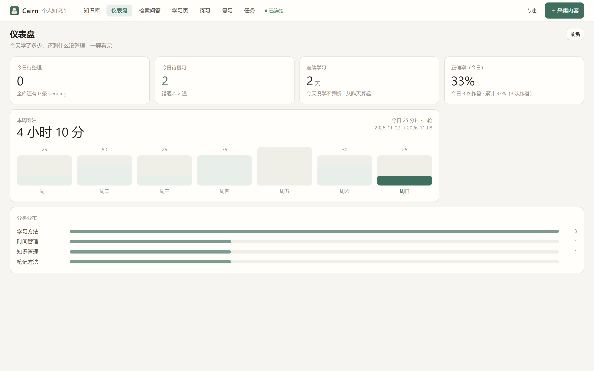

**设置** · 齿轮打开模态窗口，四个页签。模型页两张服务卡各自配 Key 与接口地址、一键探测出对方真正支持的模型，四类任务（整理 / 问答 / 出题 / 批改）分别指定模型与思考强度；外观页有 6 套配色 × 明暗 × 字号三档；下载页是四个可选组件的安装卡；关于页显示版本、构建信息与检查更新。**改完即时生效，不用重启。**

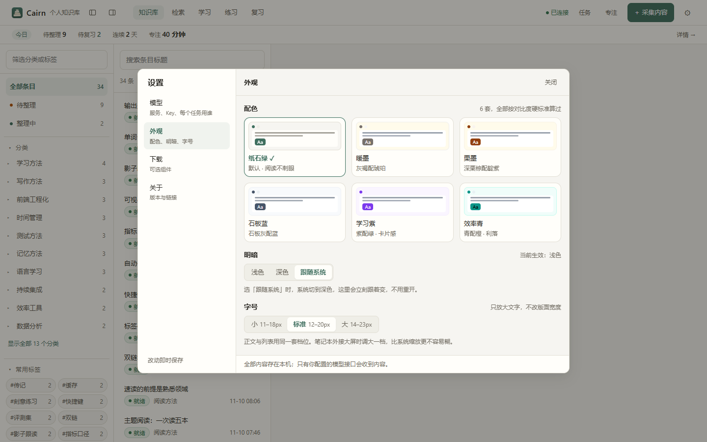

**下载（可选组件）** · 向量检索 / 视频转录 / 网页渲染 / 本地识别四个组件按需安装，用到再装；进度、取消、重试、卸载都在这页，卸载会显示释放了多少空间。（这张是源码运行时拍的，所以状态写「用本机已装的库」；安装包里显示「未安装」）

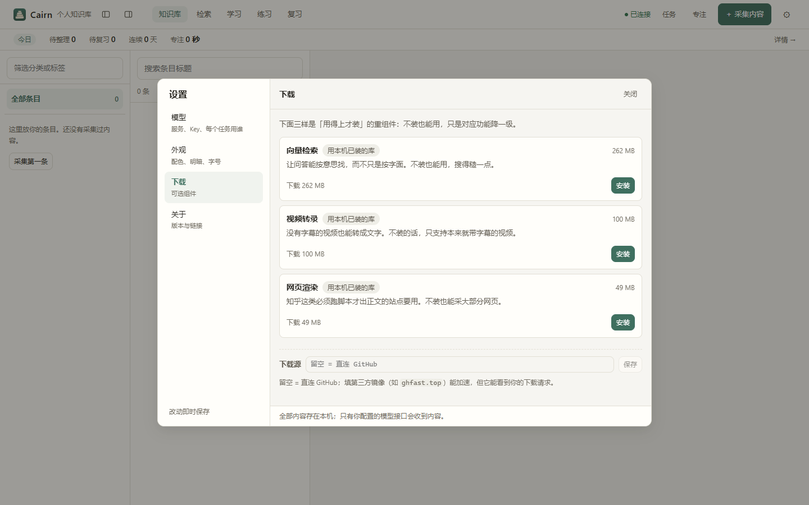

**深色** · 6 套配色各有深色版，也可以跟随系统。深色底按各自主色的色相推，所以六套在暗色下仍然互相区分；正文与按钮文字都按对比度硬标准算过。

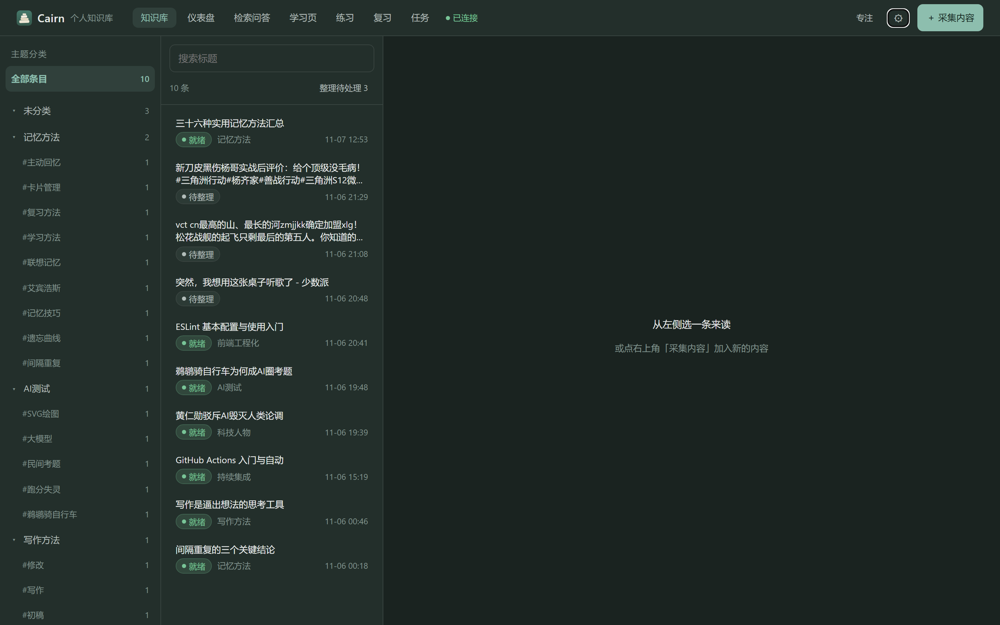

## 下载与安装

**系统要求**：Windows 10 / 11，x64。**不需要装 Python、Node 或 ffmpeg**，安装包自带运行时和 ffmpeg。

1. 到 [Releases](https://github.com/ChenYiming-aaa/Cairn-StudyKB/releases) 下载 `Cairn-0.2.1-setup.exe`（约 **172 MB**）
2. 双击安装。若弹出蓝色的「Windows 已保护你的电脑」，点 **更多信息 → 仍要运行**（没有代码签名，不是病毒告警）
3. 可以改安装目录；默认装在当前用户目录下，**不需要管理员权限**
4. 首次启动会先起本地后端，握手成功才建窗口，所以不会白屏
5. 没配 Key 会自动进引导页：粘贴 Key → 保存 Key → 变绿 → 去知识库（想换服务商、按任务分模型，点引导页上的「打开设置」）

以后双击桌面或开始菜单的 **Cairn**。

### 四个可选组件（用到再装）

为了把安装包从 426 MB 压到 172 MB，向量检索、视频转录、网页渲染这三块重依赖被拆成了**独立组件**，
在主包里不再自带。v0.3 起多第四个**本地识别**——它不是"可选增强"，是读 PDF 与图片的前提（ADR-033）。

| 组件 | 装它才能 | 大小 | 不装会怎样 |
|---|---|---|---|
| **向量检索** | 语义检索（和全文一起做混合召回） | 262 MB | 检索退化为纯全文，界面会明示 |
| **视频转录** | 没有字幕的视频转成文字 | 100 MB | 视频入库时提示「未安装转录组件」；有字幕的视频照常 |
| **网页渲染** | 抓知乎这类需要浏览器渲染的站点 | 49 MB | 这些站点会提示装组件，普通网页不受影响 |
| **本地识别** | 读 PDF 与图片（逐页出文字 + 页图对照） | 118 MB（解包 266 MB） | PDF 与图片读不出字，界面直说「先去装识别组件」；docx/pptx/xlsx 不受影响 |

装法：**设置 → 下载**（四张卡片，装/取消/重试/卸载，带进度与校验），或者首次引导页直接勾选。
下载走 GitHub，可断点续传；装完在 `%APPDATA%\Cairn\components\`，卸载就是把那个目录删掉。
前三个全装约额外 411 MB，再加识别约 529 MB —— 这是你自己选的，不是强制。

### 以后怎么更新

**设置 → 关于 → 检查更新**：读 GitHub Releases 最新版 → 显示版本号与更新说明 → 下载（可取消）
→ 校验 sha256 → 「打开安装程序」先停后端、再起安装器。安装过程**不动数据目录**。

> ⚠️ **v0.1.0 的用户这次要手动下载一次** —— 0.1.0 里还没有更新器，装上 0.2.0 之后才能在设置里自动更新。
> 更新包是全量的（约 172 MB，就是完整安装包），没有增量更新；也**不支持降级**，回退只能手动装旧版。

## 它能做什么

- **采集** — 网页抽正文入库（去导航广告）；视频优先用站点字幕，没字幕才本地转录；纯文本直接粘贴。B 站这类必须登录才给字幕的站点，可以放一份 `cookies.txt`
- **整理** — 读完全文后重写标题（≤20 字）、给摘要、拆 3–6 条要点、写带标题层级的笔记、打分类和标签；可单条或「整理全部」批量跑，结果全部可手改，手改过的笔记不会被覆盖
- **检索与问答** — 全文（FTS5，两字词也能搜）+ 本地向量两路召回；没装向量组件、或向量不可用时自动降级成纯全文并在界面上明说；检索零命中直接说「库里没有」，不调模型瞎编；每次问答自动存历史，可回看当时的来源
- **学习页与导图** — 按笔记层级现场出思维导图，配色跟当前主题；多内容生成单文件离线 HTML，可预览、下载、回看
- **出题、练习、复习** — 四种题型、三档难度；一题一屏，答完立刻给对错和解析，交卷出正确率与逐题回看；简答走模型批改并指出缺漏，批改失败记「待人工判断」，**不冤枉人**
- **专注与统计** — 15/25/50 分钟番茄钟，可暂停、提前完成、放弃，到点先冻结时长再写一句笔记；刷新、切页面、重启后端都不重置
- **按需组件与自动更新** — 向量检索 / 视频转录 / 网页渲染 / 本地识别四个组件按需安装、随时卸载；设置里检查更新、下载、起安装器，全程不动数据目录
- **本地文件与工作区（v0.3 开发中）** — docx / pdf / pptx / xlsx / 图片直接拖进来；PDF 与图片一律本地识别、逐页出文字并保留原件；自建一层工作区归类。格式与前置条件见下节
- **原文页签按格式呈现（v0.3 新增）** — 打开「原文」看到的是那份文件：PDF 页图与这一页的文字挨着放、能翻页，认不准的行标黄；Word 保留版式（标题、列表、表格）；PPT 按页出大纲（标题 / 要点 / 备注）；图片左原图右文字一眼对照

### 支持的文件格式（v0.3 开发中）

| 格式 | 文字从哪来 | 原文呈现 | 备注 |
|---|---|---|---|
| `.docx` | 直接抽取（标题层级、列表、表格） | 版式 HTML（标题 / 列表 / 表格都在） | 内嵌图片不进文字层，留给 L3 |
| `.pdf`（电子版 / 扫描件） | **一律本地识别**，自带文本层只用于校验 | 页图 + 按页文字 | 需装「本地识别」组件 |
| `.pptx` | 直接抽取 | 逐页大纲：标题 / 要点（带层级）/ 备注 | 不做像素级还原 |
| `.xlsx` | 直接抽取（只读第一张工作表） | 表格文本（纯文本原文） | 超 200 行按前 200 行读 |
| `.txt` `.md` | 直读 | 现有纯文本 | — |
| `.png` `.jpg` `.jpeg` `.webp` | **本地识别** | 左原图、右识别文字，认不准的行标黄 | 需装「本地识别」组件 |
| `.doc` `.wps` | 不支持 | — | 请另存为 `.docx` |

> PDF 与图片要先在 **设置 → 下载** 装「本地识别」组件才能读字。它是第四个按需组件，
> **不进安装包**（见上方体积说明）；缺组件时界面会明确提示，不会假装识别成功。
> **Word / PPT / Excel / 文本不需要这个组件**，它们靠结构化读取，装上组件也不会走识别。
> 单个文件上限 200 MB。
>
> 当前进度（2026-11-13）：契约与数据库结构、**上传与落盘**、**本地识别组件与服务**、
> **识别链路（渲染 → 识别 → 逐页落库 → 双栏判列 → 断点续跑）**、
> **非 PDF 抽取（docx / pptx / xlsx / txt）**、**采集面板（两个入口 + 上传进度 + 已识别 N/M 页）**、
> **工作区（自建、左栏两段、勾选批量移入、详情一个下拉）**、
> **原文页签按格式分派（PDF 页图对照 / Word 版式 / PPT 大纲 / 图片对照）**、
> **整理按内容类型分派（试卷只出卷面概览、图片只出一句话说明，都不写笔记）**
> 已完成（M9 T9.1–T9.11，CP4 已过），尚未随任何 Release 发布。
> 原件存在数据目录的 `files/<内容 id>/` 下，页图存在 `pages/<原件 id>/`；同一份文件重复上传不占额外空间；
> 删掉内容时原件与页图一并删除。
>
> 识别是后台任务：上传 2 秒内返回。**耗时看每页有多少字**，不是固定值：30 页试卷（约 350 字/页）
> 约 2–4 分钟，30 页双栏讲义（约 1500 字/页）约 7–8 分钟（实测 15.7 秒/页）。
> 采集面板把两段分开显示：先「上传中 45%」，传完变「已存好」「正在识别 12/30 页」，数字来自
> `GET /api/knowledge/{id}/ocr` 里已落库的页数，不是按时间估的。一次可选多个文件，每个一张卡各自跑；
> 上传中可以取消，取消后原件不留半份。未装识别组件时 PDF / 图片显示「已存好，但读不出字 · 去设置」，
> Word / PPT / Excel / 文本照常读。xlsx 超 200 行、txt 超 100 万字会显示「内容不全」，不假装读全了。


**原文页签**（2026-11-13 起）：按原件格式换一种呈现，不是把整份文字平铺出来。

- **PDF**：页图与**这一页**的文字挨着放（窄窗口自动上下排），按页翻；加载失败的页给占位 +「看文字」
- **Word**：抽取时就净化过的版式 HTML，标题层级、列表、表格都保留；内嵌图不显示（图不进文字层）
- **PPT**：一页幻灯片一张卡，标题 / 要点（保留缩进层级）/ 备注分三段
- **图片**：左原图、右识别文字，一屏对照；认不准的行标黄
- **txt / md / xlsx / 粘贴来的内容**：纯文本原文，问答点 `[n]` 跳过来时仍然高亮定位

识别页的每行置信度低于 0.85 会标黄，整页平均分低时页头写一句「这一页可能有错」——
认错的地方必须看得见，不能只给一份看起来很确定的文字。老数据没有行级置信度（v4 及以前识别的页），
这些内容只显示文字、不标黄。

**整理按内容类型分派**（2026-11-13 起）：普通资料照旧出标题/摘要/要点/笔记；
**试卷**只出「卷面概览」（科目、题型分布、题数、涉及知识点），**图片**只出一句话说明加图上看得出的要点 ——
这两类都不写笔记，详情页对试卷也不显示「整理笔记」页签。理由很实在：给一份卷子写"要点+笔记"，
既浪费一次模型调用，又会让学习页里塞满不是知识的内容。
正文还是占位（`[文件] 原名`，即文件还没读完）时点「整理」会被拦下（409），
不会拿占位正文写出一篇废话；批量整理遇到这种情况会跳过并在提示里说明几条还没读完。


**工作区**（2026-11-13 起可用）：左栏最上面一段是自己划的抽屉（「数据结构」「英语二」），
与下面的「分类」不是一回事 —— 工作区是你建的，分类是机器读完给的一个。两段之间有分隔线，
字重也不同。内容只能在一个工作区里，「未归类」就是还没放进任何抽屉的那些（数字实时算）。
建的时候名字 ≤20 字、**允许同名**；改名字左栏立刻跟着变；删工作区只把内容移回「未归类」，
**内容一条都不会删**。往里放东西有三个入口：列表勾选后「移到」、详情页那个下拉、
或者上传时就带上 `workspace_id`（采集面板目前还没有这个下拉，先传进去再移也一样）。

## 第一次打开要配什么

| 项 | 必需 | 怎么弄 |
|---|---|---|
| **模型 Key** | ✅ 必需 | 引导页粘贴任意 OpenAI 兼容服务的 Key（默认 DeepSeek）；填完**立刻生效，不用重启**，存在 `%APPDATA%\Cairn\.env`，重装也还在 |
| ffmpeg | 已自带 | 安装包内置，无需配置 |
| **可选组件** | 用到再装 | 向量检索 / 视频转录 / 网页渲染 / **本地识别**（读 PDF 与图片必需），见上一节。前三个不装只是能力降级；不装本地识别，PDF 与图片就读不出字 |
| 向量模型（约 92 MB） | 装了「向量检索」组件后首次检索时自动下载 | 从 `hf-mirror.com` 拉 `bge-small-zh-v1.5`；下不来就降级成纯全文检索 |
| 语音模型（约 539 MB） | 装了「视频转录」组件后首次转录音频时自动下载 | 只有「视频没有字幕」时才用到 |

> 组件只带运行时代码，**模型文件不在组件包里**——所以装了组件之后，第一次真正用到时还会再下一次模型。

改接口地址 / 换模型 / 给四类任务分开配模型：点顶栏右侧的 **⚙ 设置 → 模型**，改完即时保存、下一次调用就生效。
Key 仍然只写 `.env`，其余配置写在 `settings.json`（见下一节）。命令行用户也可以手改这两个文件，改完不用重启。

## 设置（模型 / 外观 / 下载 / 关于）

齿轮打开模态窗口，四个页签。

**下载**：四个可选组件的三态卡片（未安装 / 下载中带进度 / 已安装），可取消、可重试、可卸载并显示释放了多少空间。源码运行时如果本机已装这些库，会写「用本机已装的库」而不是假装未安装。

**关于**：版本号、提交号、构建时间（打包时注入），检查更新与手动下载链接，配置文件来源，以及数据目录位置。

**模型**：
- **两套服务槽位**：`DeepSeek`（预填官方地址）与 `OpenAI 兼容`（任意 `base_url`）。点「探测」会列出对方真正支持的模型名并测一次延迟；服务不提供模型列表时会明说，手填模型名即可
- **四类任务各配一套**：整理 / 问答 / 出题 / 批改可以分别指定服务和模型。整理想省钱用小模型、问答想稳用大模型，互不影响
- **思考强度**（关/低/中/高）只会发给**声明支持**的服务；第三方网关不认这个参数时，后端会自动去掉该字段重试一次，而不是把 400 直接甩给用户
- **Key 永不回显**：界面上只有「已配置 / 未配置」，接口只返回 `has_key`，日志里不出现任何 Key

**外观**：
- 6 套配色（纸石绿 / 暖墨 / 栗墨 / 石板蓝 / 学习紫 / 效率青）× 浅色 / 深色 / 跟随系统，另有字号三档；选完立刻生效，记在 `settings.json` 的 `appearance` 里，重装也还在
- **配色不是手调的**：12 组色板（6 套 × 明暗）由 `tools/check_contrast.py` 生成并验对比度——正文 4.5:1、弱化文字与语义色 3:1，不达标就不许合；组件里写死颜色也会被验收脚本拦住

## 你的数据在哪

```
%APPDATA%\Cairn\
├─ data.db          # 全部内容：内容、分块、索引、题目、作答、计时（一个 SQLite 文件）
├─ settings.json    # 设置：模型路由、外观、组件开关（可手改，改坏会自动备份成 .bad-<时间戳>）
├─ components\      # 你装的可选组件（向量检索 / 视频转录 / 网页渲染 / 本地识别），删掉就是卸载
├─ models\          # 本地向量模型与语音模型
├─ logs\            # 运行日志
└─ .env             # 你的 Key
```

**备份**就是复制整个目录；**卸载不会删数据**，重装后内容还在（要清空得手动删这个目录）。出网只有三件事：调你配的模型接口、下载本地模型、采集你给的链接——**没有遥测，没有统计上报**。

## 常见问题

<details>
<summary><b>没有模型 Key 能用吗？</b></summary>

能打开、能粘贴文本，但整理、问答、出题都要调模型，没 Key 时这些入口直接返回 `LLM_NO_KEY` 并提示去配 Key——不会留一个注定失败的任务在队列里。
</details>

<details>
<summary><b>支持哪些模型服务？</b></summary>

任何 OpenAI 兼容的 `/chat/completions` 接口。默认 DeepSeek；硅基流动、阿里百炼、本地 Ollama 都有示例写在 [.env.example](.env.example) 里。换服务时注意 `base_url` 要不要带 `/v1`（DeepSeek 不带，多数服务带）。
</details>

<details>
<summary><b>安装包为什么还有 172 MB？为什么组件要单独下？</b></summary>

172 MB 里约 **124 MB 是 Electron 运行时本身**（Chromium + Node），再加上 Python 运行时和 `ffmpeg`。
换来的是「双击就能用、不用装任何东西」。原来还有 250 MB 的 `torch` / `playwright` 等依赖，
v0.2.0 把它们拆成三个可选组件——多数人只用得上其中一两个，没必要都下。
数据目录不在安装包也不在卸载范围内，升级和卸载都不会碰它。

**v0.3 起（本地文件与试卷导入，开发中）**：主包体积目标放宽到 **<300 MB**（当前 172 MB，预计 182 MB）；读 PDF 与图片所需的识别能力会作为第四个组件 `cairn-ocr` 走下载中心，**不并入安装包**。把识别依赖塞进主包的方案评估过：合并后只剩约 8.5 MB 余量，且会破坏组件进程隔离，已否决（见 `docs/dev/需求-v0.3-本地文件与试卷导入.md` §14 D3）。
</details>

<details>
<summary><b>怎么升级到新版本？</b></summary>

**设置 → 关于 → 检查更新**。下载、校验、起安装程序都在那里，安装过程不动数据目录。
如果你现在是 **v0.1.0**，那次要手动去 [Releases](https://github.com/ChenYiming-aaa/Cairn-StudyKB/releases)
下安装包——0.1.0 里还没有更新器。
</details>

<details>
<summary><b>卸载组件会丢东西吗？</b></summary>

不会。卸载只是删掉 `%APPDATA%\Cairn\components\<id>\` 这个目录，笔记、索引、题目、作答全在
`data.db` 里，一条不动。已有的向量索引也还在库里，重新装回组件就能接着用
——期间检索会退化成纯全文（界面会明示）。
</details>

<details>
<summary><b>Mac / Linux 能用吗？</b></summary>

代码跨平台，但**打好的安装包只有 Windows x64 版**。其他平台从源码跑前后端，见 [`docs/dev/运行与打包.md`](docs/dev/运行与打包.md)。
</details>

## 已知限制

v0.2.1 就是这样，不粉饰：

- **在线试用是静态演示**：只能看不能生成
- **安装包没有代码签名**：SmartScreen 会拦一次，正式分发需要买证书
- **更新是全量包**（约 172 MB），没有增量更新；**不支持降级**，回退只能手动装旧版
- **组件要单独下**：三个全装额外 411 MB，装完磁盘约 1.5 GB（v0.1.0 一次性就是 1.4 GB，现在按需）
- **URL 规范化只去 fragment 不去 query**：带 `?spm=` / `?utm_source=` 的同一篇文章会算两条
- **多选偶尔出现「四个选项全对」**：prompt 已约束，但没有量化断言拦住
- **题目、作答、复习记录无限增长**，没有保留策略，数据很多后仪表盘可能变慢
- **只有 Windows x64 安装包**

## 开发 / 验收素材（仅本地）

[`samples/`](samples/) 放着 16 份真实格式的导入样本：4 个主题（计算机二级 Python / Java、英语六级、大学数学）× 4 种版式（带图带表的课程 docx、10 页双栏讲义 PDF、电子版试卷、扫描拍照试卷），用于文件抽取、双栏判列、试卷结构与识别验收。配图是从网上搜到的真实素材，来源逐张记在 `samples/images/_sources.json`。

它们是本地验收素材，**不随安装包发布，16 份 docx/pdf 与配图也不进仓库**（见 `.gitignore`）；生成脚本与清单保留。验收脚本按四个主题目录**遍历全部 16 份**，不挑单组。文件清单、构造特征、自检数据和重新生成方法见 [`samples/README.md`](samples/README.md)。

**跑全部验收只要一条命令**：`python tools/regress.py`（按 `m1 → m9` 顺序，任一脚本用例失败就停并打出它最后 30 行）。只补某一段用 `--from 9`，只跑几个用 `--only 7,9`。缺 `samples/` 时相关用例记 SKIP + WARN 而不是失败 —— 干净机上不该永远是红的。

## 许可

MIT，见 [LICENSE](LICENSE)。用、改、分发都行，保留版权声明即可；不提供任何担保。第三方组件遵循各自许可（FastAPI、Vue、Electron、`faster-whisper`、`sentence-transformers`、`sqlite-vec`、`trafilatura`、`yt-dlp` 等）。

<sub>开发文档（需求文档、**执行计划**、接口契约、数据契约、里程碑台账、从源码运行、文案规范）在 [`docs/dev/`](docs/dev/)。</sub>
